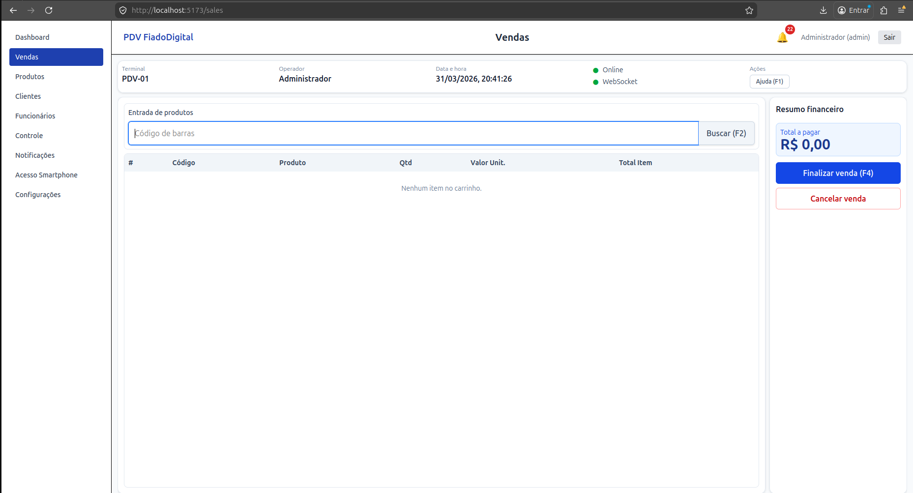
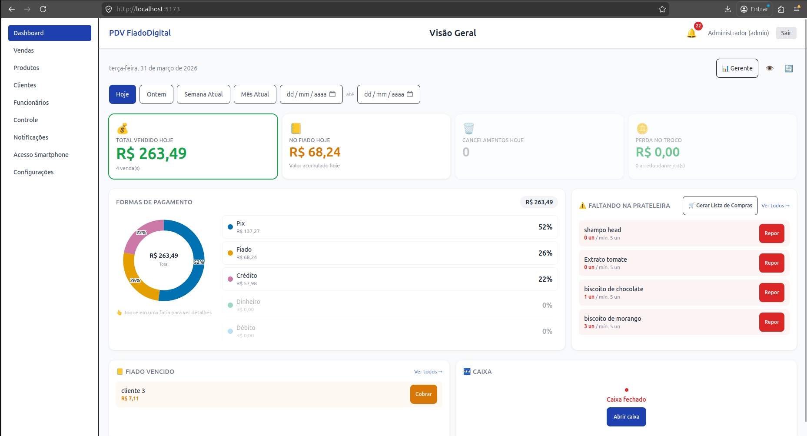
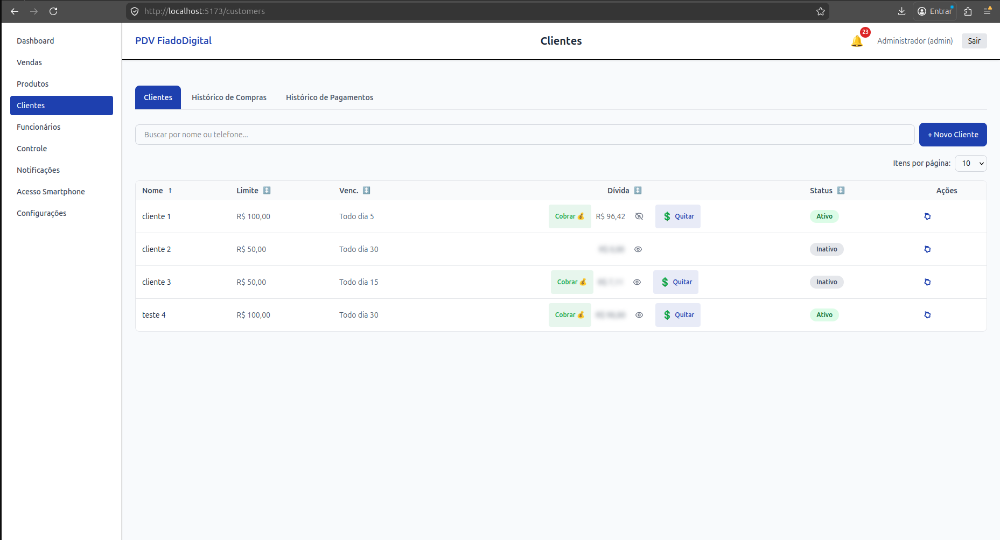
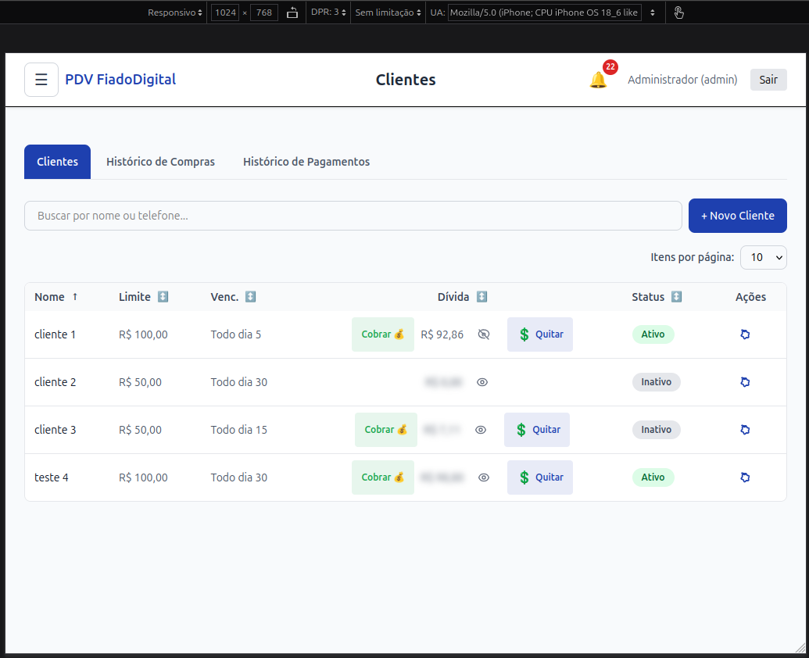
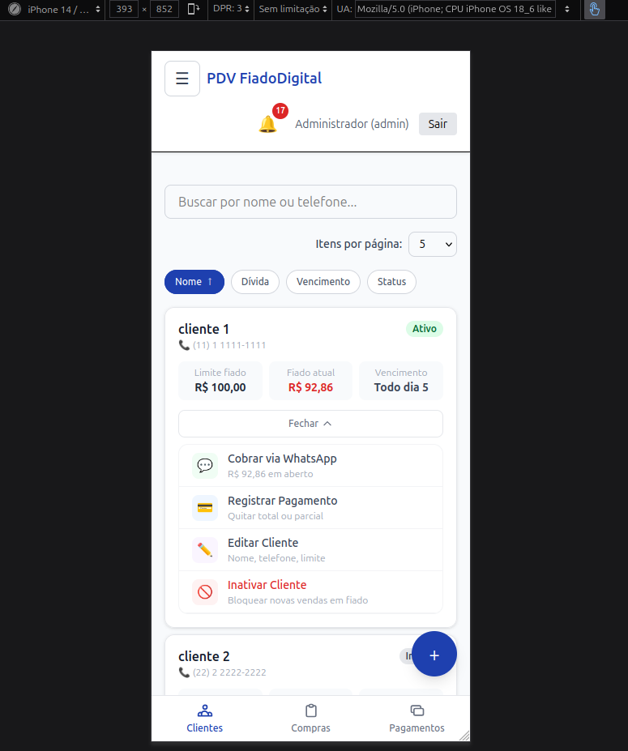
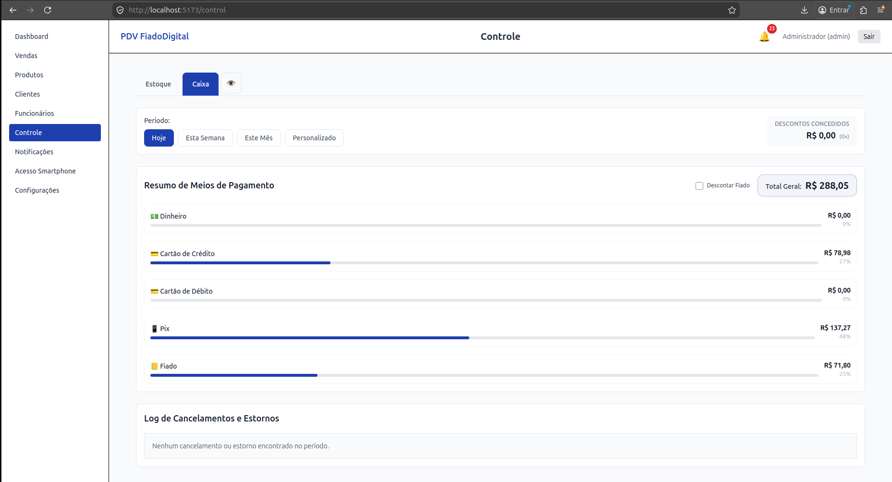
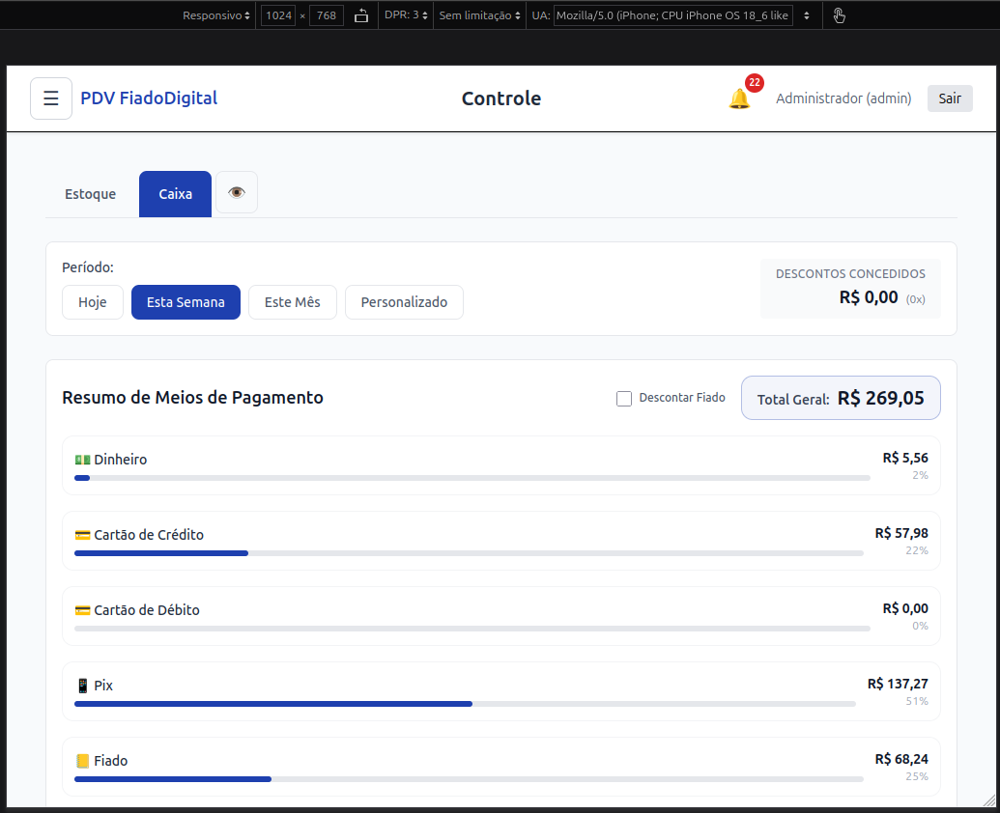
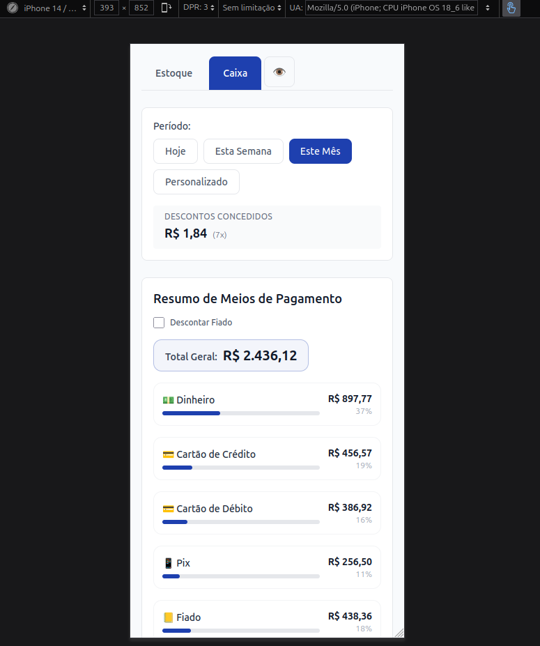

# 🏪 FiadoDigital PDV


<!-- Depois de fazer commit do .github/workflows/ci.yml, adicione o badge real:
[](https://github.com/MoisesVNdev/PDV-FiadoDigital/actions) -->


**Ponto de venda offline-first que substitui o "caderninho do fiado" de mercearias, padarias e mercadinhos.**

<!-- VERIFICAR: se o sistema estiver em uso, coloque aqui. É o argumento mais forte do projeto:
> 🟢 Em uso em [tipo/nome do comércio] desde [mês/ano], com [N] clientes e [N] vendas registradas. -->

## O problema
No comércio de bairro, vender "fiado" fideliza o cliente, mas o controle em papel gera esquecimento, briga na hora de cobrar e inadimplência sem limite.

## A solução
- **Crédito com regra:** limite por cliente, alerta ao atingir 90% e **bloqueio automático** de inadimplentes
- **Cobrança sem constrangimento:** mensagem pronta pelo WhatsApp e recibo em PDF
- **Funciona sem internet:** as vendas entram numa fila local e são reenviadas automaticamente quando a conexão volta, **sem duplicar**

| Vendas | Dashboard | Smartphone |
|---|---|---|
|  |  |  |

<details><summary>Mais telas (clientes, caixa, 1024×768)</summary>

| Desktop (1920×1080) | Desktop (1024×768) | Smartphone |
| --- | --- | --- |
|  |  |  |
|  |  |  |
</details>

---

## Funcionalidades
- **Frente de caixa:** até 2 formas de pagamento por venda (dinheiro, PIX, cartão, fiado), taxa da maquininha calculada automaticamente e arredondamento de troco configurável
- **Caderninho digital:** cadastro de clientes, limite de crédito, pagamentos parciais e quitação protegida por PIN
- **Celular como apoio:** espelhamento via QR Code, gestão do estoque da prateleira e cobrança pelo celular
- **Dashboard:** vendas por forma de pagamento, alertas de estoque mínimo e de sangria, histórico com recibos em PDF
- **Backup** manual ou agendado, com criptografia AES-256-GCM opcional e restauração por módulo

---

## Arquitetura

Monorepo com `pnpm workspaces`:

| Pacote | Tecnologia | Responsabilidade |
|---|---|---|
| `apps/api` | Node.js 20, Express 4, Prisma, Zod, ws | API REST, WebSocket e regras de negócio |
| `apps/web` | Vue 3, Vite, Pinia, Tailwind v4 | PWA do operador |
| `packages/shared` | TypeScript | Tipos e contratos compartilhados entre API e front |

```text
┌────────────┐  REST + WebSocket  ┌──────────────────────┐     ┌──────────────┐
│ apps/web   │ ◄────────────────► │ apps/api             │ ──► │ SQLite (WAL) │
│ Vue 3 PWA  │                    │ Express + Prisma     │     └──────────────┘
│ + offline  │                   │ Zod · rate limit     │ ──► Webhook PIX (PSP)
└────────────┘                    └──────────────────────┘ ──► Backup em nuvem (opcional)
```

### Decisões técnicas
| Decisão | Por quê |
|---|---|
| **SQLite em modo WAL**, local | O comércio não pode parar se a internet cair. O WAL permite leituras concorrentes durante a escrita. |
| **Fila offline com chave de idempotência** (`use-offline-queue.ts`) | Cada venda recebe um UUID gerado no próprio caixa, com índice único no banco (`Sale.uuid`). Vendas feitas sem rede ficam na fila e são reenviadas quando a conexão volta. Se a mesma venda chegar duas vezes, a API devolve a já registrada em vez de duplicar. |
| **Transações no Prisma** (`$transaction`) | Venda no fiado, pagamento de dívida, cancelamento e estorno atualizam a dívida do cliente e os registros da venda de forma atômica: tudo acontece junto ou nada acontece. |
| **Contratos compartilhados** (`packages/shared`) | API e front usam os mesmos tipos, então uma mudança de contrato quebra na compilação e não em produção |
| **WebSocket com fallback para polling** | Atualiza em tempo real o caixa e o celular pareado, sem depender do WebSocket |

---

## Segurança
- **Todas as rotas exigem autenticação**, exceto `/auth/login` e `/auth/refresh`
- **Access token de 15 minutos guardado só em memória** (Pinia) e **refresh token de 7 dias em cookie HttpOnly**: nenhum token fica no `localStorage`, então um script injetado na página não consegue ler o refresh token
- **Controle de acesso por perfil** (`admin`, `manager`, `operator`, `stockist`), aplicado por middleware em cada rota
- **PIN gerencial** (bcrypt + rate limit) em operações com risco financeiro: cancelamento, estorno e quitação de fiado
- **Senha de administrador** para alterar configurações sensíveis, como a chave PIX
- **Validação de entrada com Zod**; headers de segurança e CORS restrito à origem local (LAN) <!-- VERIFICAR: se o Zod valida todas as rotas, diga "em todas as rotas" -->

---

## Testes e CI

| Camada | Ferramenta | Escopo |
|---|---|---|
| Backend: unitários | Vitest | Serviços transacionais, repositórios e controllers <!-- VERIFICAR: % de cobertura --> |
| Frontend: unitários | Vitest + jsdom | Composables de domínio (100% de linhas) <!-- VERIFICAR: linhas ou branches? --> |
| E2E | Playwright (Chromium) | Venda, cancelamento, caixa, fiado e notificações |

<!-- VERIFICAR: o workflow .github/workflows/ci.yml NÃO está no GitHub (a pasta .github estava no .gitignore). Faça commit dele antes de publicar este parágrafo; se ele não existir, apague o parágrafo. -->
**CI (GitHub Actions):** type-check → testes unitários → build, a cada pull request para `main` (merge do tipo *squash*).

```bash
pnpm --filter @pdv/api test
pnpm --filter @pdv/web test
pnpm --filter @pdv/web test:e2e
```

---

## Como executar

Requer Node.js 20+ e pnpm 8+.

```bash
git clone https://github.com/MoisesVNdev/PDV-FiadoDigital.git
cd PDV-FiadoDigital
pnpm install
cp apps/api/.env.example apps/api/.env      # preencha JWT_SECRET e JWT_REFRESH_SECRET
pnpm db:migrate:deploy                      # aplica as migrações versionadas em prisma/migrations
pnpm db:seed
docker compose up
```

> `pnpm db:migrate` roda `prisma db push`, que sincroniza o schema **sem** gerar histórico. Use-o só para protótipos rápidos; o caminho normal é `db:migrate:deploy`.

O `db:seed` cria um operador de demonstração para você testar o sistema:

| Usuário | Senha | PIN gerencial |
|---|---|---|
| `admin` | `admin123` | `123456` |

> ⚠️ São credenciais só para teste local. Troque-as em qualquer outro ambiente.

<details><summary>Variáveis de ambiente</summary>

| Variável | Obrigatória | Descrição |
|---|---|---|
| `JWT_SECRET` / `JWT_REFRESH_SECRET` | ✅ | Chaves de assinatura dos tokens |
| `DATABASE_URL` | ✅ | Caminho do SQLite (`file:./data/dev.db`) |
| `NODE_ENV` | ✅ | `development` ou `production` |
| `CORS_ORIGIN` | ✅ | Origem permitida (ex.: `http://localhost:5173`) |
| `PORT` | | Porta da API |
| `APP_TIME_ZONE` | | Fuso horário usado nos relatórios |
| `PIX_KEY_TYPE` / `PIX_KEY` | | Chave PIX do comércio |
| `VITE_API_URL` / `VITE_WS_URL` | ✅ (web) | URLs da API e do WebSocket |
</details>

---

## Distribuição
Em produção, o front roda empacotado com **Tauri** em modo quiosque. O empacotador fica em um repositório separado.

## Roadmap
Pendências e dívida técnica estão em [`docs/info-projeto/resumo-infraestrutura-projeto.md`](docs/info-projeto/resumo-infraestrutura-projeto.md).

## Contribuindo
Veja o [guia de contribuição](CONTRIBUTING.md), o [código de conduta](CODE_OF_CONDUCT.md) e a [política de segurança](SECURITY.md).

## Autor e licença
**Moisés Vila Nova de Oliveira**: [GitHub](https://github.com/MoisesVNdev) · [moisesvn.dev@gmail.com](mailto:moisesvn.dev@gmail.com)
Licença [MIT](https://opensource.org/license/mit).
